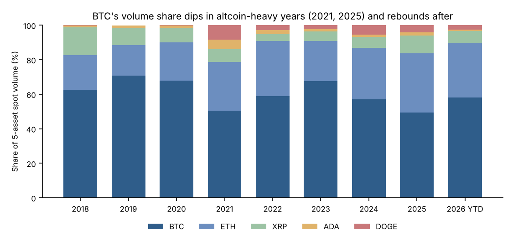
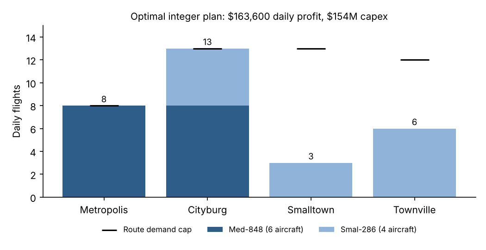

# Yitian (Adrian) Zhang | Business Analytics Portfolio

M.S. Applied Business Analytics at Boston University (expected Dec 2027) · B.A. Applied Mathematics, Kenyon College.
I turn messy business and market data into decisions, using SQL, Python, optimization and clear charts.
[LinkedIn](https://linkedin.com/in/yitian-zhang1219/) · 中文版: [README.zh-CN.md](README.zh-CN.md)

## Featured projects

| Project | Business question | Result | Tools |
| --- | --- | --- | --- |
| [**Crypto Market Intelligence**](projects/crypto-market-sql) | Which assets drive exchange volume, how risky are they, and do exchange flows predict returns? | BTC's volume share swings with the cycle, from 50% (2021, 2025) to 68% (2023). Exchange flows showed no reliable signal. | SQL (CTEs, window functions), Python, Power BI |
| [**Early-Career Talent Benchmarking**](projects/early-career-talent) | How should Accenture improve its early-career offering and recruiting messages? | 🏆 **1st place, BU ABA Hackathon 2026.** Analyzed 504 postings and 1,245 reviews, and recommended two pilot programs. | Python, regex text screening, pandas |
| [**Airline Fleet & Route Optimization**](projects/airline-optimization) | Which fleet mix and schedule maximize daily profit under a $160M budget? | Buy 10 aircraft for $154M, for $163,600 daily profit. The service-rule assumption is worth $3,200 a day. | Mixed-integer programming, SciPy, MATLAB |
| [**Loan Approval Prediction**](projects/loan-approval) | Can a simple linear classifier screen loan applications, and how much does credit score matter? | 89% test accuracy against a 73% baseline. Accuracy falls to 82% without credit score. | MATLAB, least squares, model evaluation |

<p align="center">
  
  
</p>

## More projects

- [Trading Research & Risk Terminal](projects/trading-terminal): a React app for trading plans, position sizing, pre-trade checks and trade journals.
- [Celonis Employer Analysis](projects/celonis-employer-analysis): data-quality preprocessing for 758 postings and 933 reviews; the warm-up case before the hackathon.
- [NYC Property Sales](projects/nyc-property-analysis): R analysis of Murray Hill sales using k-means clustering and t-tests.

Older coursework, quantitative research (Bitcoin dynamic allocation, a gold/Bitcoin backtest, Monte Carlo studies) and practice code are in [`archive/`](archive).

## Run

```sh
pip install -r requirements.txt
```

Each project README has its own run steps. Competition and course datasets are not redistributed (see [DATA_POLICY.md](DATA_POLICY.md)). Team projects are credited to their teams, and AI assistance is disclosed in [THIRD_PARTY.md](THIRD_PARTY.md).
