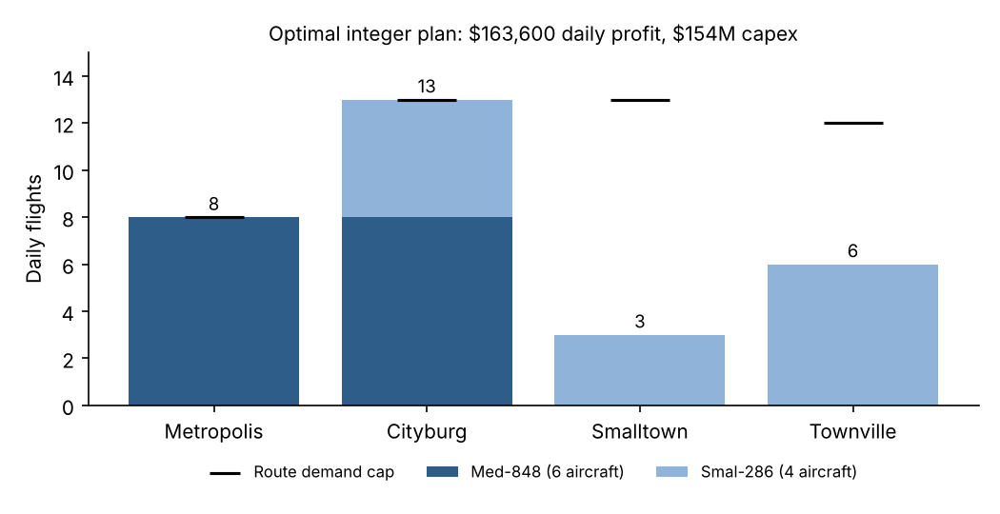

# Airline Fleet & Route Optimization

**Mixed-integer programming · Python (SciPy) · original model in MATLAB · team of 3 · Sep 2024**



## Business question

Universal Airways has a **$160M** budget to buy two aircraft types (Med-848 at $21M, Smal-286 at $7M) and must decide how to fly them across four routes. Which fleet mix and daily schedule maximizes daily profit?

## Model

- **Decisions:** daily flights per aircraft type on each route (8 variables) and aircraft purchased per type (2 variables), all integers.
- **Objective:** maximize daily profit, using the per-flight profit given in the case (some routes lose money on the larger aircraft).
- **Constraints:**
  - Flight hours used ≤ 10 hours × aircraft purchased, for each aircraft type.
  - Purchase cost ≤ $160M.
  - Each route has a daily demand cap of 8, 13, 13 or 12 flights.
  - Smalltown needs at least 3 daily flights and Townville at least 4.

## Results

| Scenario | Daily profit | Fleet | Capex |
| --- | ---: | --- | ---: |
| **Integer, minimum service (recommended)** | **$163,600** | 6 Med-848 + 4 Smal-286 | $154M |
| Integer, exact service counts (original MATLAB code) | $160,400 | 6 Med-848 + 4 Smal-286 | $154M |
| Continuous relaxation, minimum service | $170,751 | 5.7 + 5.8 (not buildable) | $160M |

- **Recommendation:** buy 10 aircraft for $154M. Fly Med-848s on the high-margin Metropolis and Cityburg routes, and cover the required regional service with Smal-286s.
- **The service rule changes the answer.** The original code required exactly 3 Smalltown and 4 Townville flights. The case asks for *at least* that many. Allowing Townville to grow to 6 flights (profitable on the Smal-286) adds $3,200/day without buying another plane.
- **Integrality costs about $7,000 a day.** The continuous model spends the full budget on fractional aircraft. Integer constraints leave $6M of budget unspent, because no whole-plane combination fits it better.

All figures are model outputs for a textbook case, not real airline data.

## Run it

```sh
pip install -r ../../requirements.txt
python fleet_model.py      # prints all scenarios, writes outputs/scenarios.csv and outputs/optimal_plan.png
```

`archive/original_matlab_model.m` is the team's original `intlinprog` model, and `archive/original_report.tex` is the original report. The original report gives $160,400 because it used the exact-count rule.
