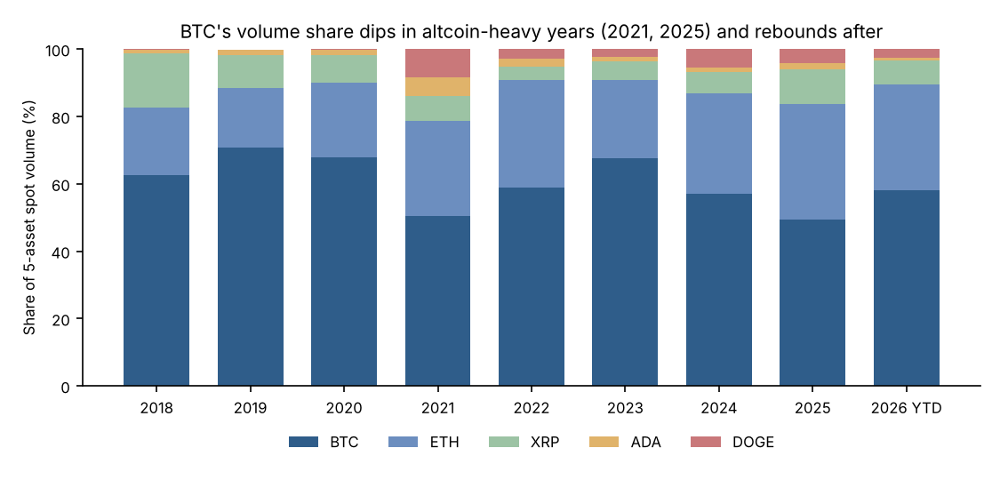
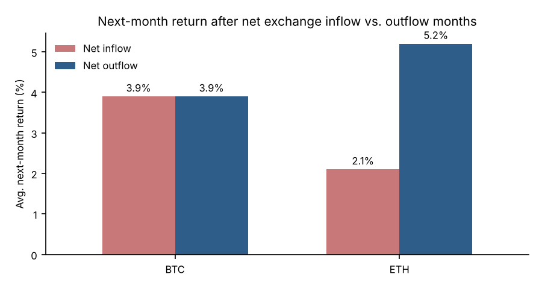
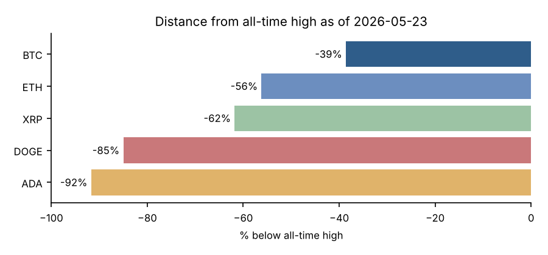

# Crypto Market Intelligence: SQL Analysis

**SQL (SQLite) · Python · Power BI · public on-chain and market data, 2018 – May 2026**

The scenario: a growth team at a crypto exchange wants to know which assets drive trading activity, how risky each one is, and whether on-chain signals such as exchange flows tell them anything. This project answers those questions with six SQL queries against a daily market database for **BTC, ETH, XRP, ADA and DOGE**.



## Key findings

1. **BTC's lead in volume share moves with the market cycle.** BTC's share of five-asset spot volume fell to about 50% in the altcoin-heavy years 2021 and 2025, then rose to 68% in 2023 and 58% in 2026 YTD. ETH's share rose from 20% in 2018 to 34% in 2025. Exchange listing and liquidity plans should not assume BTC dominance stays constant.
2. **BTC is the lowest-risk asset in the set.** Across 2018–2025, BTC's median annualized volatility was 65%, against 82–100% for the others. Its median worst drawdown within a year was −49%, against −58% to −66% for the others.
3. **Exchange flows were a weak signal at most.** For BTC, months of net inflow and months of net outflow were followed by the same average return (+3.9%). For ETH, outflow months were followed by +5.2% against +2.1% after inflow months, but the next month was up only 52% vs. 47% of the time. That gap is too small to trade on.
4. **On May 23, 2026, every asset was well below its all-time high.** BTC was 39% below its October 2025 peak. ADA and DOGE were still 85–92% below peaks set in 2021.

 

## Queries

| File | Business question | SQL techniques |
| --- | --- | --- |
| [01_volume_share.sql](sql/01_volume_share.sql) | Which assets drive spot volume, and how is the mix shifting? | CTE, `JOIN`, `SUM() OVER` share, `RANK()`, `LAG()` YoY |
| [02_risk_return.sql](sql/02_risk_return.sql) | How do return, volatility and drawdown compare by year? | Chained CTEs, `LAG()` log returns, running `MAX() OVER`, self-join for year close |
| [03_exchange_flow_months.sql](sql/03_exchange_flow_months.sql) | Monthly net exchange flow and the next month's return | `LEAD()`, named `WINDOW`, `CASE` labels |
| [04_exchange_flow_summary.sql](sql/04_exchange_flow_summary.sql) | Are outflow months followed by better returns? | Aggregation over labeled windows, hit rate |
| [05_network_activity.sql](sql/05_network_activity.sql) | Is on-chain usage growing alongside price? | Yearly aggregation, `LAG()` YoY growth |
| [06_drawdown_from_ath.sql](sql/06_drawdown_from_ath.sql) | How far is each asset from its all-time high? | `ROW_NUMBER()` to rank by price and by date, date math |

The full result of each query is saved in [`outputs/`](outputs) as a CSV.

## Data

- **Source:** [Coin Metrics Community Data](https://github.com/coinmetrics/data), CC BY-NC 4.0, snapshot through 2026-05-23.
- **Table:** `daily_metrics` has one row per asset per day (21,631 rows). Columns: price, market cap, reported spot volume, active addresses, transactions, and exchange inflow/outflow in USD. Exchange flows are available for BTC and ETH only.
- **Caveats:** reported spot volume includes all exchanges Coin Metrics tracks, so it may include wash trading. 2026 figures cover January 1 to May 23 only. All findings are descriptive. None of them is a trading recommendation.

## Run it

```sh
pip install -r ../../requirements.txt
python build_db.py          # builds data/crypto.db from data/daily_metrics.csv
python run_analysis.py      # runs sql/*.sql, writes outputs/*.csv and charts
```

To refresh the data, download `btc/eth/xrp/ada/doge.csv` from the Coin Metrics repository and run `python build_db.py --source <folder>`.

## Power BI dashboard

[`powerbi/README.md`](powerbi/README.md) describes the dashboard built on the same tables: the data model, DAX measures and page layout.
