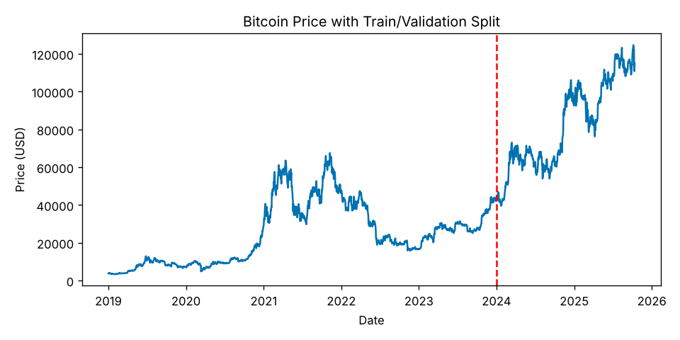
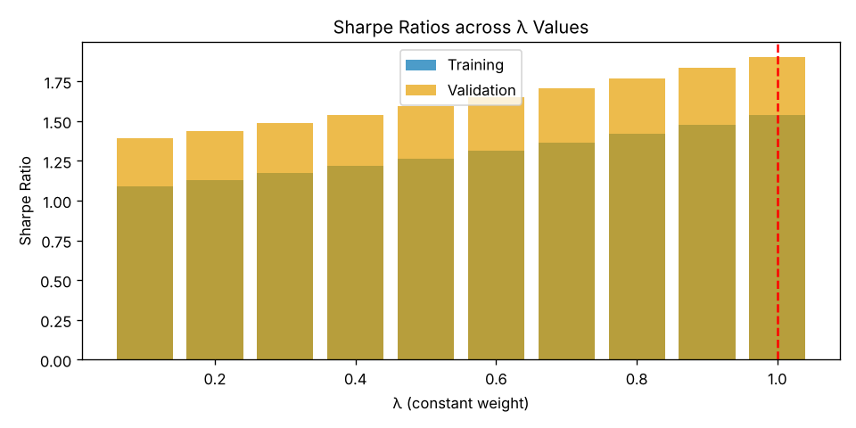

# Reproduction: constant-weight Bitcoin experiments

**Status: both supporting R scripts were rerun on recent data. The final dynamic-programming (Bellman) model is still unrecovered and was not reproduced.**

`btc_rerun.py` is a line-for-line Python port of [`constant_weight_train_validation.R`](../archive/constant_weight_train_validation.R) and [`constant_weight_visualization.R`](../archive/constant_weight_visualization.R). It keeps the same parameters: a 0.1% one-way cost, rebalancing every 5 days, a training set ending 2023-12-31, a validation set ending 2025-10-12, and annualization with 365 days. It also keeps the two scripts' original cost logic unchanged, including the `abs(w - w)` term described in the project README.

The input is a TradingView BTCUSD daily export. It is not included in this repository. The data start on 2019-01-01 to match the "2019–2025" chart title in the original visualization script. Run it with `python3 btc_rerun.py <csv> 2019-01-01`. The full output is in [`output.txt`](output.txt) and the figures are in [`figures/`](figures).

## Results

| Validation period (2024-01-01 to 2025-10-12) | Annual return | Annual volatility | Sharpe | Max drawdown | Final value |
| --- | --- | --- | --- | --- | --- |
| λ* chosen on training data = 1.0 (fully invested) | 97.0% | 48.6% | 1.99 | −28.1% | 2.72× |
| All cash (λ = 0) | 0% | 0% | n/a | 0% | 1.00× |

Starting the data in 2014 instead of 2019 gives the same choice, λ* = 1.0.

## What the rerun shows

The grid search selects λ = 1, which is buy-and-hold, whatever the data period. This follows from how the scripts are built:

- Annual return is computed as (1 + mean daily return)^365 − 1, which grows faster than linearly in λ, while volatility grows only linearly in λ. Training Sharpe therefore increases with λ at every step, from 1.07 at λ = 0.05 to 1.54 at λ = 1.
- Turnover cost is charged only on the first trade, or never in the visualization script, so a larger position carries no extra cost.

These constant-weight experiments therefore cannot beat buy-and-hold. The capstone poster's claim that the dynamic-programming policy outperforms buy-and-hold depends on the unrecovered Bellman implementation (`expected_reward()`) and is not verified here.

